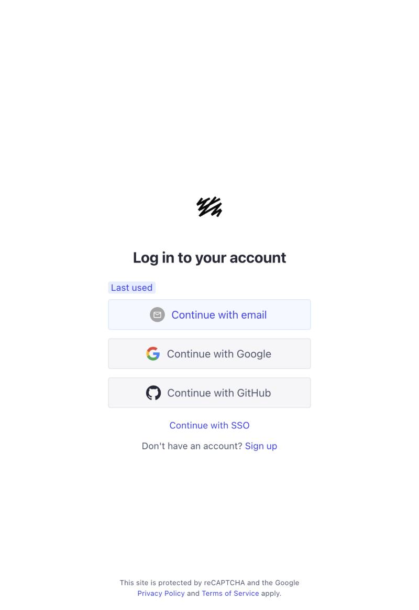
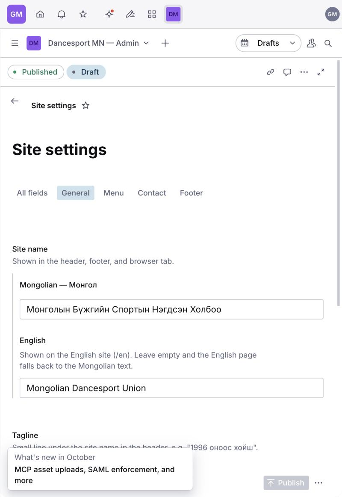
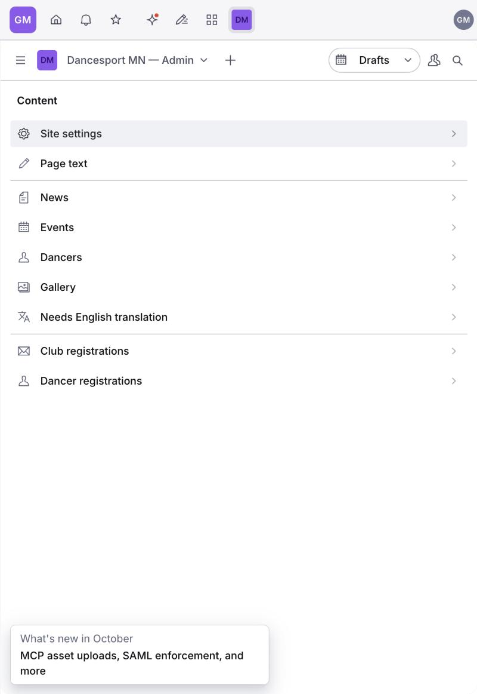
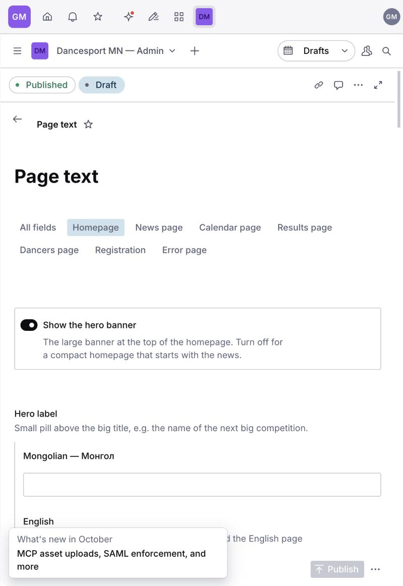
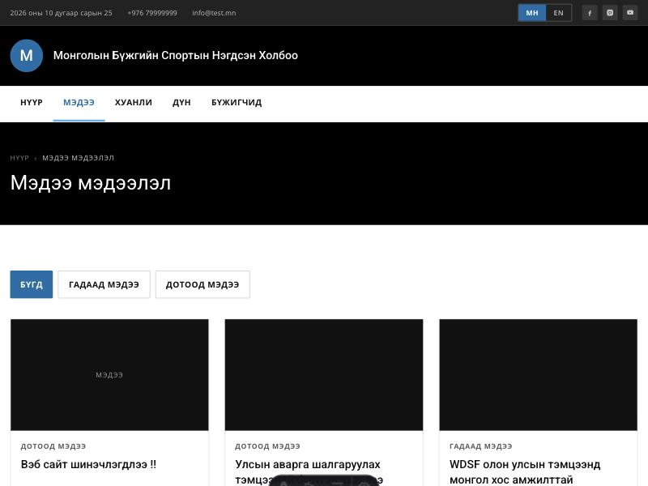
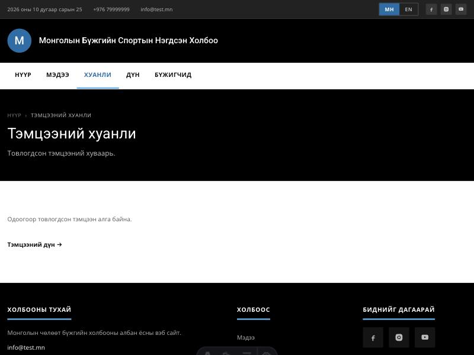
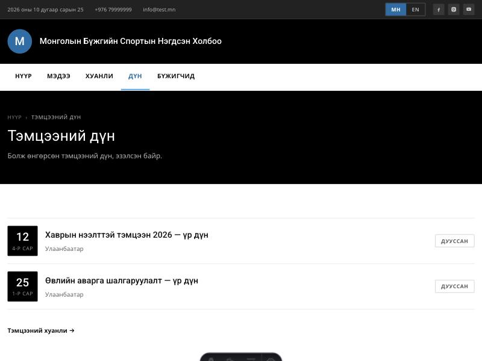
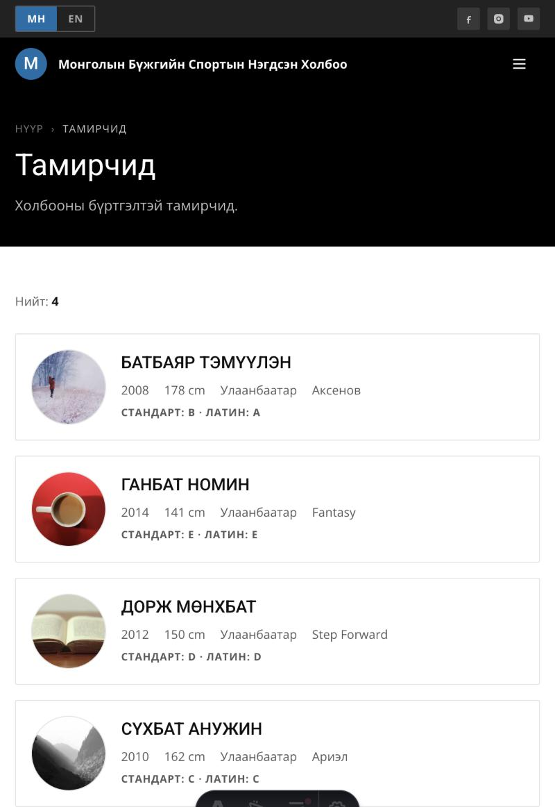
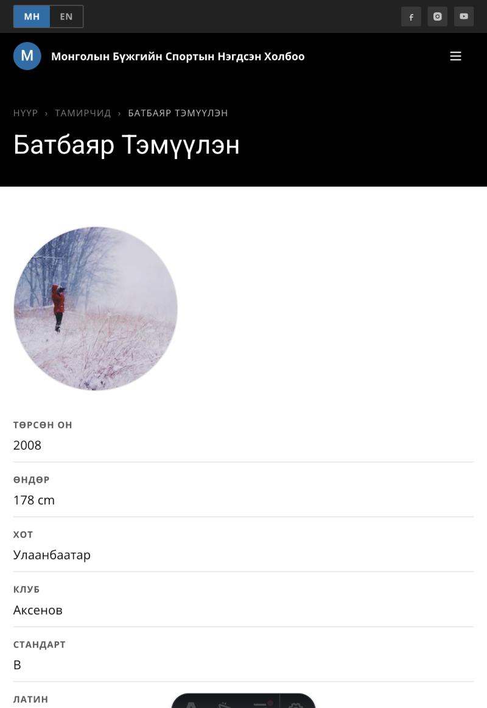
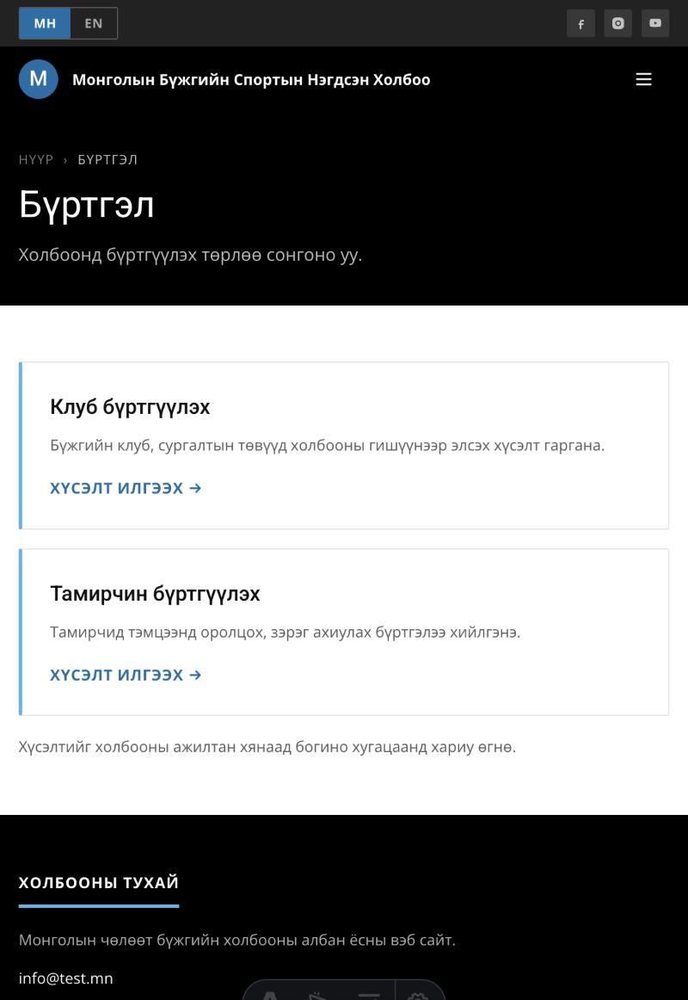

# Админы гарын авлага

**Админ хэсэг:** https://dancesport-mn.sanity.studio
Компьютерээс нээнэ үү.

---

## 1. Нэвтрэх

Урилга авсан аргаараа нэвтэрнэ — и-мэйлээр урьсан бол **Continue with email**.
Google-ээр нэвтэрвэл *"эрх байхгүй"* гарна.

---

## 2. Хадгалах ≠ Нийтлэх ⚠️

- **Published** — одоо сайт дээр байгаа
- **Draft** — хадгалсан ч **нийтлээгүй**
- Баруун доор **Publish** товч

**Publish дарахгүй бол сайт дээр гарахгүй.** Дараад 1 минут хүлээгээд сайтаа
сэргээнэ (refresh).

---

## 3. Цэс

| | |
|---|---|
| **Site settings** | Нэр, лого, цэс, утас, и-мэйл, хөл |
| **Page text** | Хуудас бүрийн гарчиг, текст |
| **News** | Мэдээ |
| **Events** | Тэмцээн — Хуваарь / Дүн |
| **Dancers** | Тамирчдын профайл |
| **Gallery** | Зургийн цомог |
| **Club / Dancer registrations** | Ирсэн хүсэлтүүд |

---

## 4. Site settings үү, Page text үү?

- **Бүх хуудсан дээр** гардаг → Site settings
- **Нэг хуудсан дээр** гардаг → Page text

Page text дотор хуудас бүр таб-тай. Нүүрний хэсгүүдийг эндээс асааж/унтраана.

---

## 5. Мэдээ нийтлэх

**News → All articles → +**

1. Гарчиг, зураг, агуулга
2. **Publishing** таб → Slug дээр **Generate**, ангилал, огноо
3. **Publish**

⚠️ Slug-ийг нийтэлсний дараа **бүү өөрчил** — тарсан холбоос эвдэрнэ.

---

## 6. Тэмцээн нэмэх

**Events → Schedule → +** → нэр, огноо, байршил → **Publish**

Нүүр болон хуанлид өөрөө гарч, огноогоор эрэмбэлэгдэнэ.

---

## 7. Дүн оруулах

**Events → Results → +** → **Result details**-д байруудыг мөр мөрөөр бичнэ →
**Publish**

---

## 8. Тамирчин нэмэх

**Dancers → Currently competing → +**

1. Овог, нэр, **Generate**, зураг, төрсөн он, хот, клуб
2. **Sport** таб: өндөр, Стандарт / Латин зэрэг
3. **Results** таб: тэмцээн, байр, ангилал, хамтрагч
4. **Publish**

---

## 9. Профайл ингэж харагдана

Зураг дугуй тул **царайг голлуулж** тайрна.
Тэмцээнээс завсарлавал устгахгүй — **Currently competing** унтраана.

---

## 10. Бүртгэлийн хүсэлт

**New — needs review** → нээх → утас/и-мэйлээр холбогдох → профайл үүсгэх →
**Status: Reviewed**

---

## 11. ⚠️ Нууцлал

Бүртгэлийн маягт **утас, и-мэйл, төрсөн огноо** агуулдаг. Бүртгүүлэгчид
ихэвчлэн **хүүхэд**.

**Профайл руу зөвхөн:** нэр, төрсөн **он**, хот, клуб, өндөр, зэрэг, зураг
**Хэзээ ч үгүй:** утас, и-мэйл, бүтэн төрсөн огноо

---

## 12. Алдаа гарвал

| Шинж | Шийдэл |
|---|---|
| Өөрчилсөн ч сайтад гараагүй | **Draft** тэмдгийг шалга → Publish → 1 мин хүлээ |
| Админд хоосон, сайтад текст бий | Талбар хоосон тул үндсэн текст гарч байна. Бөглөвөл таных гарна |
| "Unknown fields found" | Cmd/Ctrl + Shift + R → хөгжүүлэгчид хэл |
| Нэвтэрсэн ч "эрх байхгүй" | Буруу аргаар нэвтэрсэн. Гарч, зөв аргаар орно |
| Sanity "trial дуусч байна" | Хэвийн. Үнэгүй багцад шилжинэ, төлбөргүй |

---

## 13. Бусад

- **Шинэ админ:** sanity.io/manage → Members → и-мэйлээр урих.
  Аль аргаар нэвтрэхийг нь заавал хэл.
- **Англи талбар:** хоосон орхивол англи хуудас монголоор харагдана.
  Дутууг нь **Needs English translation** хэсгээс хар.
- **Зураг:** том хэмжээгээр оруулаад тайрна. Сайт өөрөө хэмжээг тааруулна.
- **Шинэ хуудас, шинэ талбар, дизайн** — админаас биш, хөгжүүлэгчээс.
